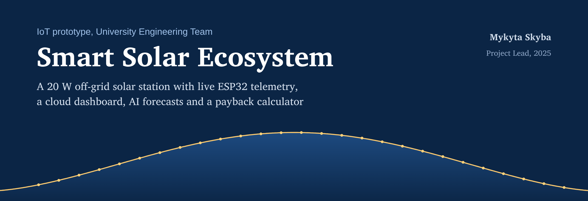
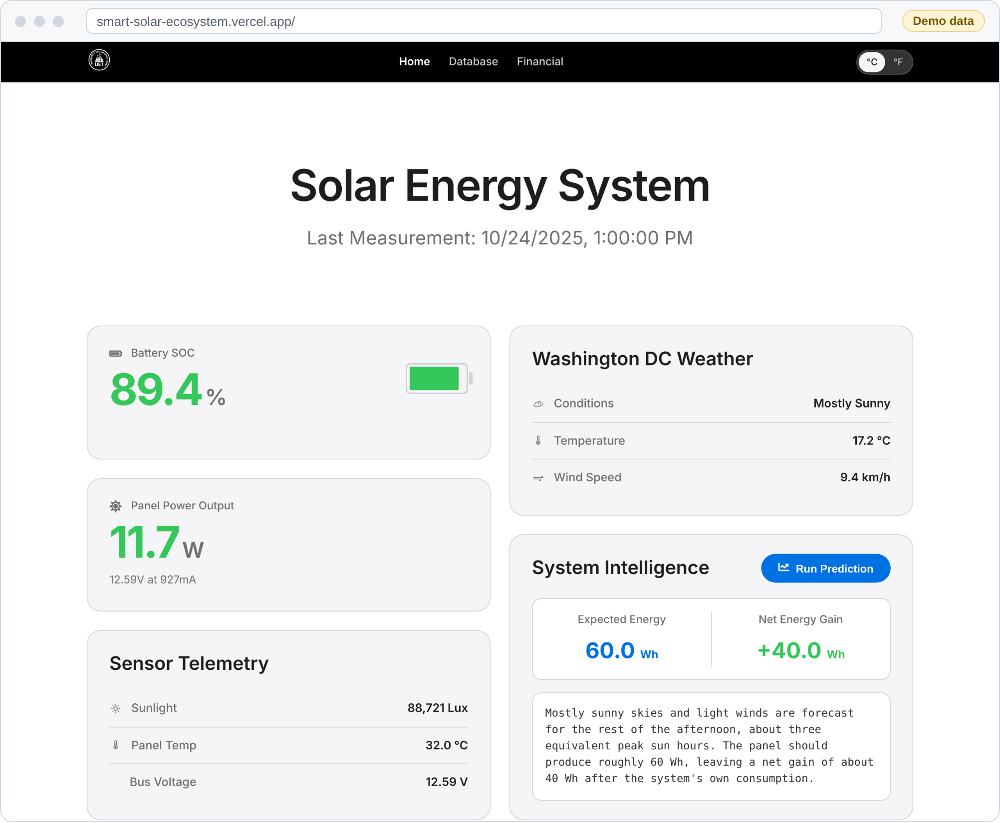
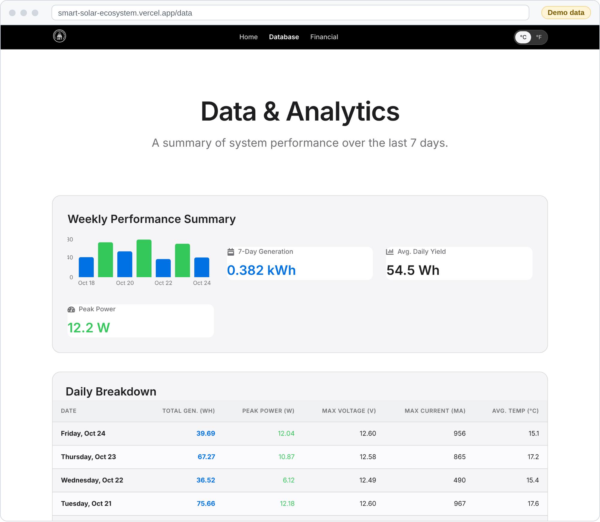
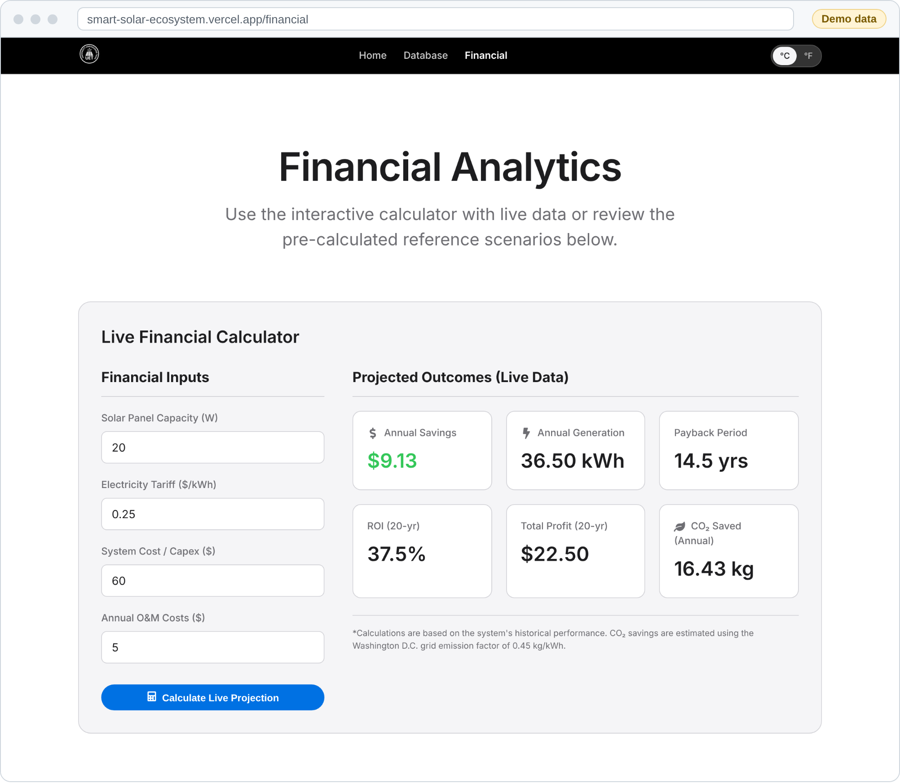
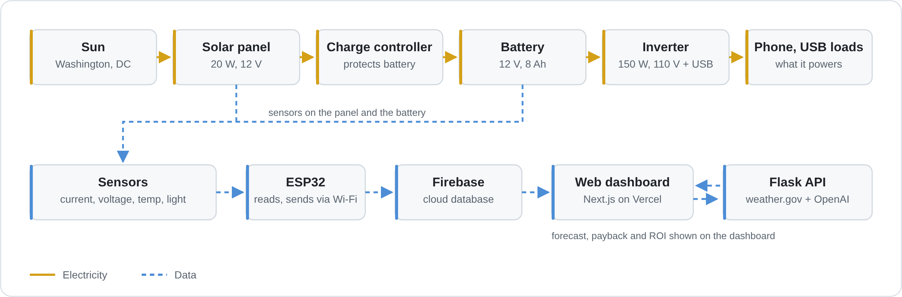

<a href="https://smart-solar-ecosystem.vercel.app/"></a>

<p align="center"><a href="https://smart-solar-ecosystem.vercel.app/"></a></p>

<p align="center">A small off-grid solar station that reports on itself.<br>It measures its own panel and battery, sends the data to the cloud and shows it on a web dashboard<br>with an AI forecast and a payback calculator.</p>

## The idea in 30 seconds

A typical small solar kit, with a panel, a battery and an inverter, tells you nothing about itself. We added sensors and a small Wi-Fi computer (an ESP32), so the station now:

1. **Measures** panel power, battery voltage, temperature and sunlight.
2. **Sends** the readings over Wi-Fi to a cloud database (Firebase).
3. **Shows** them on a web dashboard: live output, battery charge and history by day.
4. **Predicts** today's energy from the weather forecast, using an AI model (OpenAI).
5. **Calculates** savings, payback time and return on investment.

## The dashboard



<table>
  <tr>
    <td width="50%"></td>
    <td width="50%"></td>
  </tr>
  <tr>
    <td align="center"><sub>History: energy by day</sub></td>
    <td align="center"><sub>Payback calculator</sub></td>
  </tr>
</table>

<sub>The station is packed away for now, so the live site shows its last stored reading. These screenshots come from the dashboard's own code running on demo sensor data; the financial figures come from the dashboard's own calculator.</sub>

The calculator also shows why size matters. At $0.25 per kWh the 20 W prototype pays back in about 14.5 years, while the 20 kW commercial scenario in the financial model pays back in about 6.

## How it works

<picture>
  <source media="(prefers-color-scheme: dark)" srcset="assets/solar-how-it-works-dark.png">
  
</picture>

The top row is the energy path. The bottom row is the data path.

## Hardware

| Part | Model | What it does |
|---|---|---|
| Solar panel | SOLPERK 20 W kit | Makes DC electricity from sunlight |
| Charge controller | Included in the kit | Charges the battery safely |
| Battery | ExpertPower 12 V, 8 Ah, sealed lead-acid | Stores the energy |
| Inverter | 150 W | Turns 12 V DC into 110 V AC and USB power |
| Microcontroller | ESP32 | Reads the sensors and sends the data over Wi-Fi |
| Current and voltage sensor | HiLetgo INA219 | Measures the power coming from the panel |
| Temperature sensor | BOJACK DS18B20, waterproof | Measures the temperature of the system |
| Light sensor | Lux sensor module | Measures sunlight |
| Buck converter | HiLetgo LM2596 | Powers the electronics from the main battery |

## Built with

| Layer | Tools |
|---|---|
| Device | ESP32 (Arduino), INA219, DS18B20 |
| Cloud | Firebase Realtime Database; a Flask API in Docker on Google Cloud |
| Website | Next.js and React on Vercel, Recharts; every push to `main` redeploys the site |
| Data and AI | National Weather Service API for the forecast, OpenAI GPT-3.5 Turbo for the prediction |

## What is in this repository

| Folder | What is inside |
|---|---|
| [frontend-dashboard/](frontend-dashboard/) | The Next.js dashboard: live data, history and the payback calculator |
| [backend-api/](backend-api/) | The Flask API for the weather forecast and the AI prediction |
| [documentation/](documentation/) | System diagrams and the original screenshots |

<details>
<summary><b>Run it yourself</b></summary>

You need Node.js 18 or later, Python 3.9 or later, a Firebase project and an OpenAI API key.

**Dashboard** (`frontend-dashboard/`)

```sh
cd frontend-dashboard
npm install
```

Create `.env.local` with your Firebase settings:

```
NEXT_PUBLIC_FIREBASE_API_KEY=YOUR_KEY
NEXT_PUBLIC_FIREBASE_AUTH_DOMAIN=YOUR_DOMAIN
NEXT_PUBLIC_FIREBASE_DATABASE_URL=YOUR_URL
NEXT_PUBLIC_FIREBASE_PROJECT_ID=YOUR_ID
NEXT_PUBLIC_FLASK_API_URL=http://127.0.0.1:5000
```

Then run `npm run dev`.

**API** (`backend-api/`)

```sh
cd backend-api
pip install -r requirements.txt
export OPENAI_API_KEY='your_secret_key'
flask run
```

</details>

## Team

Built by the [University Engineering Team](https://www.linkedin.com/in/uet-university-engineering-team-aa9005392). Project Lead: [Mykyta Skyba](https://www.linkedin.com/in/m-skyba).
